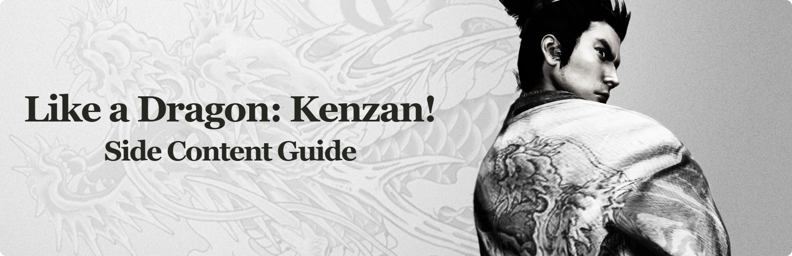

**Version 0.1.** This fan guide covers all 140 substories in the English translation of Like a Dragon: Kenzan! It includes detailed walkthroughs, an interactive map, story objective filters, and checklists for training, inventions, and collectibles, plus yūjo routes and Revelations.

This fan project was vibe-coded with AI assistance while playing the English translation.

- [Open the live Side Content Guide](https://neophoriac.github.io/kenzan-guide/)
- [Open the interactive map](https://neophoriac.github.io/kenzan-guide/#quest-map)

Progress and story objective preferences are saved in the browser.

Thanks to the guide authors and translation team who made this project possible.

- Patrick Coffman (ThePatrick) for his walkthroughs. [GameFAQs](https://gamefaqs.gamespot.com/ps3/943326-ryu-ga-gotoku-kenzan/faqs/52464) · [Scribd](https://www.scribd.com/document/480711319/Ry%C5%AB-ga-Gotoku-Kenzan-sub-story-guide)
- KHHSubs for substory routes, maps, and references. [KHHSubs’ Kenzan guide](https://www.khhsubs.com/kenzan/)
- Aeris for the Japanese side content guides. [Aeris’ commission guide](https://coool.noor.jp/aeris/ryu3/kake01.html)
- The English translation team for bringing Kenzan to English-speaking players. [English translation patch](https://www.moddb.com/mods/ry-ga-gotoku-kenzan-english-translation-patch)

The in-game map artwork comes from Like a Dragon: Kenzan! by SEGA.
